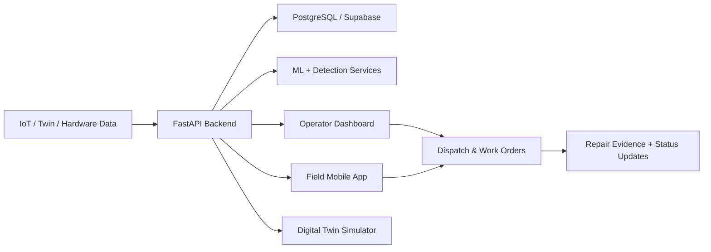

# AquaPulse

<p align="center">
  
  
  
</p>

AquaPulse is a smart water network monitoring and response platform designed to detect water leaks early, prioritize repair operations, and coordinate engineers in real time. Built for the Infothon 7.0 SDG challenge, it combines AI-assisted anomaly detection, a live digital twin simulation, operator dashboards, and a mobile field-workflow for maintenance teams.

## Why this project matters

Water loss is a major operational and sustainability challenge. AquaPulse helps utilities and field teams:

- detect leaks earlier using sensor and telemetry analysis,
- reduce non-revenue water losses,
- dispatch the right engineer faster,
- document repair evidence in the field,
- monitor system health from a centralized operational dashboard.

This work aligns directly with SDG 12 by improving resource efficiency, reducing waste, and enabling more responsible water infrastructure management.

## Product overview

AquaPulse is composed of four complementary systems:

- Backend API: FastAPI service with analytics, rules, worker jobs, and event workflows
- Web Operations Console: React + Vite dashboard for operators and teams
- Digital Twin: simulation environment to model pipe conditions and leaks
- Mobile App: Flutter app for field engineers to review jobs and submit repair evidence

## Key features

### Operational intelligence
- Leak detection and anomaly scoring
- Severity classification and impact analysis
- Real-time dashboard for active events and system KPIs
- Public impact summaries and network overview

### Field operations
- Engineer work order assignment and handling
- Location-aware dispatch and routing support
- Evidence capture with photos and repair submission
- Push notifications and status tracking

### Infrastructure simulation
- Pipe network modeling and leak injection scenarios
- Digital twin telemetry for testing detection logic
- Simulation workflows for operator training and validation

### Platform engineering
- PostgreSQL/Supabase-backed data layer
- API-based architecture with FastAPI
- Authentication, authorization, and secure workflows
- ML-ready training and model registry support

## Repository structure

```text
SDG-12-Kinetics/
├── README.md
├── Aquapulse/
│   ├── app2/                  # Web dashboard (React + Vite)
│   ├── backend/               # FastAPI backend and ML services
│   ├── digital-twin/          # Simulation / monitoring twin app
│   └── mobile/                # Flutter app for field engineers
├── .gitignore
└── LICENSE (if present)
```

## Architecture at a glance



## Tech stack

- Frontend: React, Vite, JavaScript/JSX
- Backend: Python, FastAPI
- Database: PostgreSQL, Supabase
- Mobile: Flutter, Dart
- ML / analytics: Python-based training pipeline and model registry
- Simulations: Node.js + Vite digital twin

## Getting started

### 1) Backend

```bash
cd Aquapulse/backend
python -m venv .venv
source .venv/bin/activate   # Windows: .venv\Scripts\activate
pip install -r requirements.txt
uvicorn app.main:app --host 0.0.0.0 --port 8000 --workers 1
```

For setup and database migrations, see:
- `Aquapulse/backend/README.md`

### 2) Web operations app

```bash
cd Aquapulse/app2
npm install
npm run dev
```

### 3) Digital twin simulator

```bash
cd Aquapulse/digital-twin
npm install
npm run dev
```

### 4) Mobile app

```bash
cd Aquapulse/mobile
flutter pub get
flutter run
```

## Project modules

### `Aquapulse/backend`
Contains the system core: event ingestion, anomaly detection, dispatch workflows, ML training scripts, database migrations, and service logic.

### `Aquapulse/app2`
Contains the operator-facing web application with dashboards, alerts, dashboards, event detail views, and map-driven operations.

### `Aquapulse/digital-twin`
Provides a local digital twin for generating and simulating pipe conditions and leak scenarios.

### `Aquapulse/mobile`
Supports engineers in the field with authentication, issue tracking, work order management, documentation, and evidence capture.

## SDG 12 impact

AquaPulse contributes to sustainable and efficient resource use by enabling:

- lower water loss through quick detection,
- smarter maintenance planning,
- reduced unnecessary field visits,
- better network resilience and asset longevity,
- responsible infrastructure operations at scale.

## Team

- Team: Kinetics
- Event: Infothon 7.0
- Focus: Sustainable development through intelligent water management

## Notes

This repository brings together multiple parts of a full product stack and is structured as a hackathon-ready system prototype. Each component is designed to demonstrate how modern monitoring, AI, and field workflows can work together in a real-world utility operation.

## License

This project is currently developed for hackathon use and may be treated as proprietary unless otherwise specified by the team or organization.

---

Built with purpose for cleaner, smarter, and more sustainable water management.
